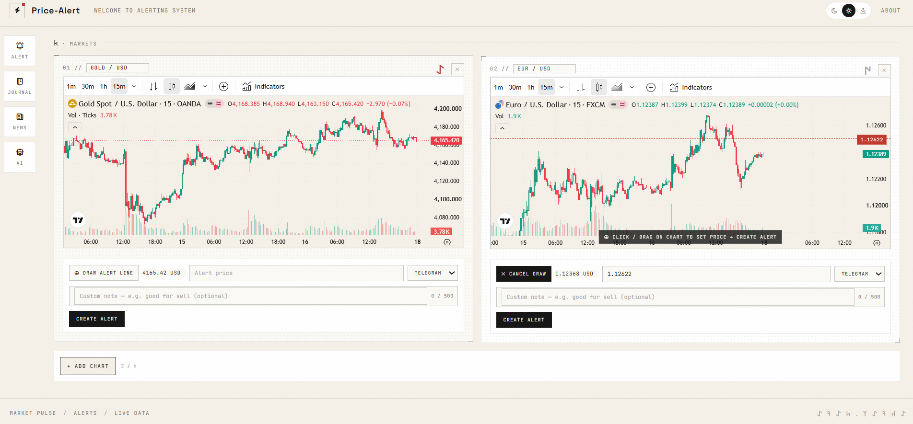
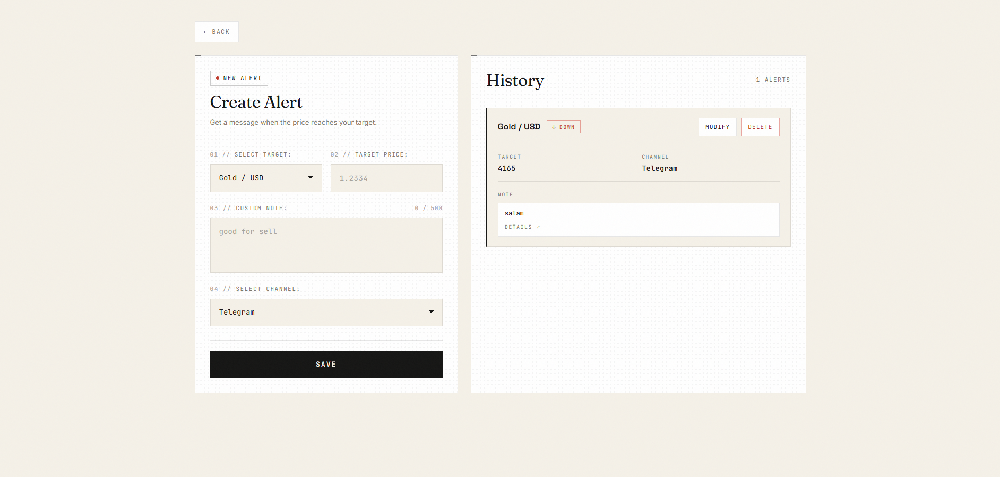
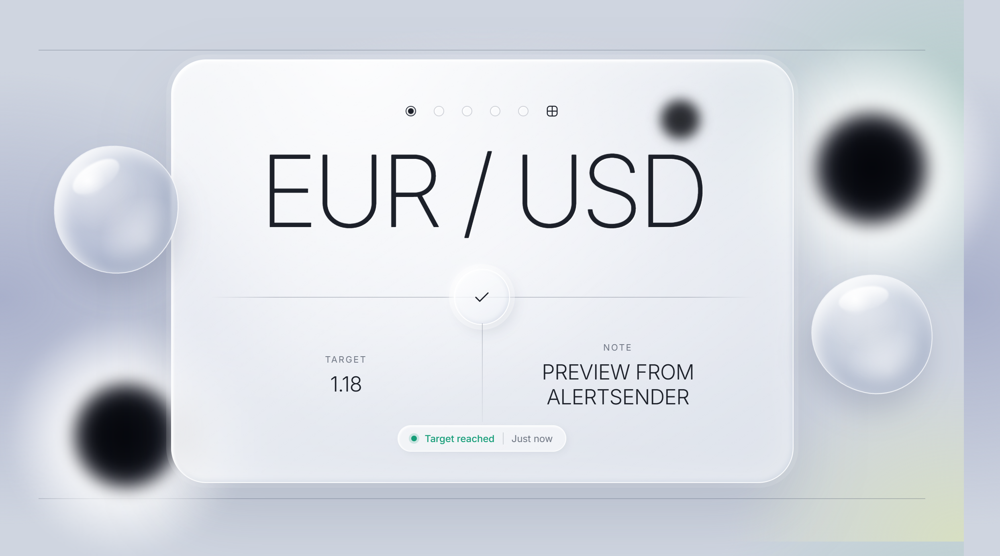
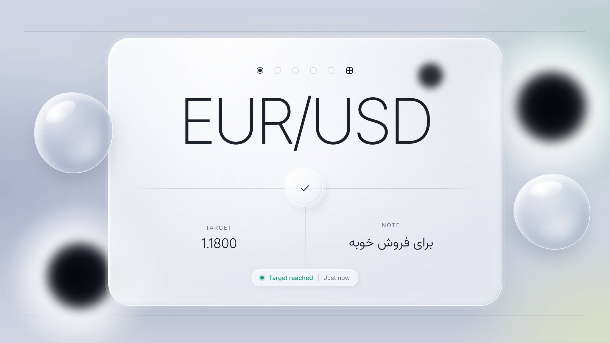
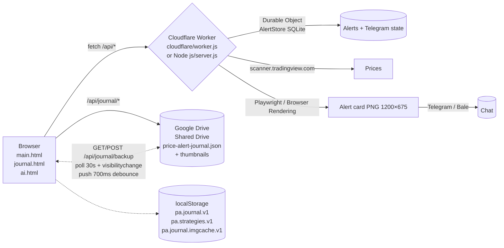

<p align="center">
  
  <br/>
  <sub style="letter-spacing:.22em; color:#8b877b">DOSSIER · MARKETS · JOURNAL · ALERTS</sub>
</p>

<h1 align="center" style="font-family: Fraunces, Georgia, serif; font-weight:400; letter-spacing:-.02em; margin-bottom:4px">
  Trading Alert System
</h1>
<p align="center" style="color:#8b877b; font-family: JetBrains Mono, monospace; font-size:12px; letter-spacing:.14em; text-transform:uppercase">
  Near-black · Bone-white · Hairline dossier · Kanji pulse — markets that feel like paper
</p>

<p align="center">
  <a href="#-preview"></a>
  <a href="#-quick-start"></a>
  <a href="#-design--animations"></a>
  
  
</p>

<p align="center" style="max-width:720px; margin: 16px auto 0; color:#8b877b; line-height:1.7">
  Price alerts for <b style="color:#e9e4d6">Gold/USD · EUR/USD · GBP/USD · BTC/USD · NASDAQ & S&P 500</b> (cash CFDs via <code>OANDA:NAS100USD / OANDA:SPX500USD</code>) with Telegram / Bale / App image notifications — plus a desktop <b style="color:#e9e4d6">Journal dossier</b> that lives on <b style="color:#e9e4d6">Google Drive</b> and stays in sync with the site at all times. Every trade, every delete — mirrored live.
</p>

<p align="center">
  <a href="CLOUDFLARE.md"><b>☁︎ Deploy on Cloudflare →</b></a> &nbsp;·&nbsp;
  <a href="#-journal--drive-live-mirror">Journal Drive Sync</a> &nbsp;·&nbsp;
  <a href="#-adding-another-api">Add another API</a>
</p>

---

### <span style="font-family: Fraunces">✦</span> Table of contents

- [Preview](#-preview) — screenshots & where to put your GIFs
- [What it is](#-what-it-is)
- [Features](#-features)
- [AI Console](#-ai-console) — full-screen chat, skills, provider keys via Cloudflare
- [Design & Animations](#-design--animations) — every motion, in detail
- [Architecture](#-architecture)
- [Quick start](#-quick-start)
- [Journal — Drive live mirror](#-journal--drive-live-mirror)
- [Cloudflare Workers](#-cloudflare-workers)
- [Adding another API](#-adding-another-api)
- [Project structure](#-project-structure) · [Scripts](#-scripts) · [Troubleshooting](#-troubleshooting)

---

### <span style="font-family: Fraunces">◍</span> Preview

> Near-black dossier, hairline borders, bone paper — every page as it actually looks.

> ⚠️ **Why you see broken images:** the 5 you just pasted in chat are **not saved to `Pictures/` yet** — the folder on disk still only has `alert-preview.png` + `alert-sent-preview.png` (see below). Follow the 30-second fix right under the gallery.

<!-- 5 slots — will render as soon as you save the files with these exact names: -->
<!-- Pictures/01-markets.png  Pictures/02-alerts.png  Pictures/03-journal-trade.png  Pictures/04-journal-form.png  Pictures/05-analyze.png -->

<!-- These use raw HTML so GitHub doesn't collapse them; if the file is missing GitHub shows a broken-icon — that disappears once you save the file. -->

<p align="center">
  
  <br/>
  <sub style="color:#8b877b; font-family: JetBrains Mono, monospace; font-size:11px; letter-spacing:.08em">01 — MARKETS · <code>Public/main.html</code> — dual TradingView Advanced Charts (15m) · draw alert line → target · 75% chart view · black-down / green-up candles</sub>
</p>

<table>
<tr>
<td width="50%" align="center">

**02 — Alerts · Create & History**

`Public/Alert/alert.html`



<sub>Target · price · note <code>0/500</code> · channel <code>All→Both</code></sub>

</td>
<td width="50%" align="center">

**03 — Journal · Dossier card**

`Public/journal.html`


<sub><code>01 — 1min · 02 — 15min · 03 — 1h</code> · Drive thumb + <code>0/120</code> caption</sub>

</td>
</tr>
</table>

<p align="center">
  
  <br/>
  <sub style="color:#8b877b; font-family: JetBrains Mono, monospace; font-size:11px; letter-spacing:.08em">04 — JOURNAL FORM · pair / date / direction / outcome / strategy / PnL · tags · notes · 3 slots  <code>Choose file… (Uploads to Drive)</code> or paste Drive / TradingView link</sub>
</p>

<p align="center">
  
  <br/>
  <sub style="color:#8b877b; font-family: JetBrains Mono, monospace; font-size:11px; letter-spacing:.08em">05 — ANALYZE · donut <code>WIN/LOSS/BE</code> · histogram · strat/pair tables · slim weekday candles · streak <code>W×n</code> · switchable calendar <code>‹ › Today</code></sub>
</p>

> **Currently on disk:** `Pictures/` contains only the 2 legacy files below. The 5 above will appear instantly once you save them with those names — GitHub uses the exact filename (case-sensitive).

<p align="center" style="opacity:.9">
  
  
  <br/>
  <sub style="color:#5b584f; font-family: JetBrains Mono, monospace; font-size:10px">legacy fallbacks — still visible because they already exist on disk · replaced by the 5 above once you save them</sub>
</p>

<details>
<summary><b>📂 Where the files live</b></summary>

```
Pictures/
  01-markets.png        ← Image 1 — Markets (Gold/EUR 15m dual charts)
  02-alerts.png         ← Image 2 — Create Alert + History
  03-journal-trade.png  ← Image 3 — Journal dossier card (WIN · BOS RETEST 15M)
  04-journal-form.png   ← Image 4 — New Trade form (choose file / paste link)
  05-analyze.png        ← Image 5 — Analyze dashboards
  alert-preview.png     ← legacy fallback (kept)
  alert-sent-preview.png← legacy fallback (kept)
```

> Save the 5 images you sent with **exactly those names** in `Pictures/` and push — GitHub renders them immediately. No code change needed.

</details>

<details>
<summary><b>🎬 How to add beautiful GIFs (optional, recommended sizes)</b></summary>

```sh
# record with any tool, then optimize:
# 1280×720, 12–15 fps, 6–8s loop, < 6 MB

# put them here:
Pictures/markets-draw-to-alert.gif    # draw a horizontal line → alert fires
Pictures/journal-analyze.gif          # scroll Analyze dashboards
Pictures/journal-calendar-filter.gif  # click calendar day → dossiers filter
Pictures/alert-notification.gif       # Telegram image card arriving
```

Then add below the gallery:

```html


```

GitHub auto-plays GIFs. Keep the `.png` fallbacks — bump `?v=2` if a GIF doesn't refresh.

</details>

**Live pages (local):** `http://localhost:3000/main.html` · `journal.html` · `news.html` · `Alert/alert.html` · `chart-snapshot.html`

---

### <span style="font-family: Fraunces">—</span> What it is

A **single-owner, self-hosted trading desk** — not a multi-tenant SaaS. One dashboard, one Durable Object, one Drive backup. Built to feel like a printed dossier: bone paper on near-black, hairline rules, mono labels, a tiny red tick on the brand mark, and every interaction animated just enough to feel alive.

| Surface | What lives there |
|---|---|
| **`main.html` — Markets** | Up to 6 TradingView Advanced Charts (75% chart, `0×0` hidden widgets), pair selector per chart, draw-to-alert overlay, channel `All (Both)` + inline `0/500` note |
| **`journal.html` — Journal** | 3 shots per trade `01·1min / 02·15min / 03·1h` (Drive file or TradingView link + `0/120` caption), strategies, text-only allowed, Analyze dashboards, switchable calendar |
| **`news.html`** | Same-origin `GET /api/events` → `chartevents-reuters.tradingview.com/events` (fallback `events.json`) |
| **`Alert/alert.html`** | Create / edit / delete alerts (validated `pair/target/channel/note`, max 100) |

---

### <span style="font-family: Fraunces">✧</span> Features

<table>
<tr>
<td width="33%">

#### Markets
- **6 persisted charts** (`pa.charts.v1` → `Max 6`, `+ Add chart X/6`, `✕` remove, `rebuildDOM`)
- **Hidden widgets only** · `embed-widget-advanced-chart.js` + `embed-widget-symbol-info.js` at `0×0 isTransparent:true`; visible chrome is our bone/blood CSS + `JetBrains Mono / Fraunces`, not iframe chrome
- **75% chart view** · `si-chart-wrap--fill flex:3 min-height:360px`, card `min-height:560px`
- **Candles** black down `#0a0a0a` / green up `#16a34a`, no Up/Down pill, clean bar `Draw + live + price + channel + Create + note`
- **Draw-to-alert** · `pa-overlay` `inactive→active`, Y↔price `rangePct` per pair, `POST /api/alerts {pair,target,note,channel,source:'website'}`
- **Live trigger screenshot** `renderAlertPng` `1200×675` (wait iframe 12s + 4.5s) fallback `renderAlertCard`
- **Scroll only center** · `body 100dvh overflow:hidden flex column`, `header sticky`, `main flex:1 min-h-0 overflow:hidden`, `content scroll-behavior:smooth scrollbar-gutter:stable`

</td>
<td width="33%">

#### Journal — Dossier
- **3-slot upload** `Choose file…` (dossier `j-file-btn` style, `input[type=file] display:none` + label) + Drive/TradingView link + `j-cap-input` bone line mono `0/120`
- **Drive live mirror** · every create/edit/**delete** debounced 700ms `POST /api/journal/backup` → Shared Drive `price-alert-journal.json`; on open + 30s poll + `visibilitychange` pull → site ↔ Drive in sync at all times
- **Strategies** `pa.strategies.v1` (`BOS retest 15m, Breakout, Range, Liquidity sweep` defaults) — chips bar, filter, per-trade select
- **Filters** pair / outcome / strategy / search + calendar day
- **Pairs** `Gold / EUR / BTC / GBP / NASDAQ / S&P 500` → `OANDA:XAUUSD, FX_IDC:EURUSD, BITSTAMP:BTCUSD, OANDA:NAS100USD, OANDA:SPX500USD`
- **Images** optional (text-only needs notes), titles `1min / 15min / 1h`, thumbnail `https://drive.google.com/thumbnail?id=ID&sz=w1200` proxied `GET /api/drive/thumb/:id` + `pa.journal.imgcache.v1` `dataURL` cache

</td>
<td width="33%">

#### Analyze — Dashboards
All **filtered-aware** (respect pair/outcome/strategy/search + calendar day):

- **KPIs** · Profit factor · Avg win/loss · Expectancy · Best/Worst · Long/Short · Streak
- **Donut** `drawDonut` — WIN/LOSS/BE with `stroke-dasharray` on `100` circumference
- **Histogram** `drawHist` — 8 bins + zero line `stroke-dasharray 3 3`
- **Bars** `drawStratBars` — horizontal PnL by strategy
- **Weekday edge** — slim candles `14px max 44%` + 1px wick, `54px` scale, baseline `rgba(233,228,214,.08)`
- **Streak** `drawStreakSeq` — `W×n / L×n / B×n` sequence, last 20 streaks
- **Calendar** — current month, `Mon–Sun` head, `win/loss/has` cells, **switchable**: `‹ › Today`, click day → dossiers filter `Filtering: YYYY-MM-DD ✕`
- **Equity** `drawEquity` — cumulative curve, hire `#3bc47a` else `#d13b2f`

</td>
</tr>
</table>

**Alerts & delivery**
- `js/server.js` checker `10s` · migrates `storedAlerts[].symbol → pairToSymbol[pair]`, `truncateToPrecision` + `state up/down`, logs `[check]/[triggered]/[migrate]`, `GET /api/check-now` debug, `data/alerts.json` persisted
- `GET /api/prices` → `scanner.tradingview.com/global/scan` tickers
- `channel: ['Bale','Telegram','Both','App']` — `All` label normalizes to `Both`, `telegram.mjs` early-return for `App`
- Notification images via **Playwright** (Node) / **Cloudflare Browser Rendering** (Workers) from `js/alertCard.js` (original card HTML, unchanged)

---

### <span style="font-family: Fraunces">✦</span> AI Console

> `ai.html` — a full-screen, Mistral-grade chat surface wearing the same dossier skin: drifting red/bone orbs over a panning hairline grid, staggered word-reveal hero, blur-in messages, streaming caret, scanning "analyzing" chip, rotating conic send ring.

**Skills (modes) — 3 built in, add more from the UI**
- **Market Analyst** `ti-chart-candle` — bias, key levels, invalidation, next action
- **Alert Architect** `ti-bell-ringing` — trade idea → entry / stop / TP ladder as ready-to-enter console fields
- **Journal Coach** `ti-notebook` — process-over-outcome review, one rule per week
- **+ New skill** — name, icon, tagline, system prompt → `POST /api/ai/skills` (up to 24 custom, editable/deletable; built-ins are protected). Each skill rewrites the system prompt server-side, so the browser can't drop the mode it's chatting under.

**Settings — API keys typed in the site, stored on Cloudflare**
- Header **Settings** (every page) opens the slide-over: providers (**Mistral AI, OpenAI, Anthropic, Groq, Google Gemini, custom OpenAI-compatible**), key field with reveal toggle, model + base URL, **Test**, **Use in chat**, **Remove** — plus **Tavily Search** (optional, powers the `web_search` tool; keyless search works without it)
- Keys are saved `PUT /api/ai/providers` → Durable Object (`aiSettings`) / `data/ai-settings.json` on Node — responses only ever carry a masked preview (`sk-••••••••9876`). The raw key is used server-side to call the provider; the browser never sees it again. `data/ai-settings.json` is gitignored
- **Demo channel** works with zero keys: the console streams a local canned reply so the UI is fully usable before configuration

**Chat plumbing**
- `POST /api/ai/chat` — SSE events: `{delta}` streaming text, `{reset}` (a tool-call block is replaced by chips), `{tool}` (running/done chip), `{done}` (with `toolCalls`), `{error}` — or plain JSON with `stream:false`; skill prompt + tool protocol prepended server-side; per-skill threads persisted in `localStorage pa.ai.v1`
- Providers normalized in `js/aiCore.js`: OpenAI-compatible (`chat/completions`), Anthropic (`/messages`), Google (`streamGenerateContent?alt=sse`) — all re-emitted as one delta format
- Same-origin writes only (host-based check survives TLS-terminating proxies), dashboard Basic auth on Workers as everywhere else

**Console data tools — the chat reads your own function outputs**
- The model can call the dashboard's real functions mid-answer (provider-agnostic tool loop: reply with a fenced `tool` JSON block → server runs the function → feeds the result back → answer with the data; max 3 rounds):
  - `get_prices` — live prices via `getPrices()` (the same function the charts use)
  - `list_alerts` / `list_triggered` — pending alerts and trigger history from the store
  - `journal_summary` — win/loss/BE, net pnl, per-pair breakdown, recent trades from the journal backup
  - `get_events` — this week's economic calendar (TradingView events proxy)
  - `web_search {query}` — **web search**: keyless DuckDuckGo by default, or save a **Tavily** key in Settings for better results
  - `get_time`
- Every call shows as a live chip in the message (`⚙ get_prices · 2 pairs ✓`) and the raw outputs are the app's own — no invented data
- The **demo channel** runs the same tools for real, so the preview answers with actual alerts/journal/prices even before an AI key exists

**Animations (all `prefers-reduced-motion` guarded):** boot stagger (rail slides in, composer rises), hero word-by-word reveal with `--d` delays, orb drift 26s/32s loops, grid pan 80s, message `blur(5px)→0` entrances (user from right, assistant from left with a drawn red hairline), blinking caret + scan shimmer while streaming, thinking-dots + scanning chip, conic-gradient send ring on `has-text`, rotating gear badge, toast slide-ins, drawer blur/slide with staggered sections.

---

### <span style="font-family: Fraunces">◐</span> Design & Animations

> The whole site is a **paper dossier on a darkroom wall**. Every motion is hairline, not flashy.

#### Palette & type

```
--bg          #0a0a0a    near-black ground
--panel       #101010    card ground
--panel-2     #141414
--bone        #e9e4d6    paper — labels, borders, primary buttons
--muted       #8b877b    secondary labels
--dim         #5b584f    captions, empty states
--red         #d13b2f    alert accent — dot, loss
--up          #3bc47a    win / profit
--line        rgba(233,228,214,.14)
--line-strong rgba(233,228,214,.38)

--font-serif  Fraunces      9..144 400 — headings, dossier titles
--font-mono   JetBrains Mono 400/500 — every label, KPI, pill, caption
--font-ui     Inter 400/500       — body fallback
--font-display Space Grotesk 500/600 — brand
--font-orkhon Noto Sans Old Turkic — 𐱅 accent
MyFont        data:font/ttf;base64 (font-display: swap → block for CF Browser Rendering)
--header-h 68px  --footer-h 62px
```

#### Every animation, named

| Animation | Where | How it moves |
|---|---|---|
| **`pulse` 2s ease-in-out infinite** | `.status-pill .dot` (header) | `opacity 1 ↔ .25` — heartbeat red dot |
| **Film grain** | `body::before` fixed `inset:0 z-index:100 opacity:.05 pointer-events:none` | `feTurbulence baseFrequency .9 numOctaves 2 stitchTiles` — dithered paper |
| **Smooth scroll** | `html {scroll-behavior:smooth}` + `.content {scroll-behavior:smooth scrollbar-gutter:stable}` | Only center scrolls; header/sidebar/footer stay fixed |
| **Hairline hover** | `.j-btn`, `.j-card:hover`, `.j-week-bar`, `.j-cal-cell.clickable:hover` | `border-color .2s`, `filter:brightness(1.06)` on primary, `transition:height .25s ease` on bars |
| **Draw-to-alert** | `pa-overlay` + `pa-overlay-line` | `inactive → active` class toggle; Y→price via `rangePct` (gold .015 / eur .008 / NAS .015 / SPX .012) |
| **Modal / Lightbox** | `#j-modal.open {display:block}`, `#lightbox.open {display:grid}` backdrop `rgba(0,0,0,.6) blur(2px)` → `rgba(0,0,0,.85)` | Fade via display toggle; `max-height:92dvh overflow:auto` dossier |
| **Analyze reveal** | `#analyze {display:none} #analyze.open {display:block}` + `Analyze ▾ → ▴` | Instant toggle, charts redraw on open (`drawDonut/Hist/StratBars/Week/Streak/Cal/Equity`) |
| **Donut** | `drawDonut` SVG `42×42` | `stroke-dasharray pct (100-pct)` + `stroke-dashoffset 25-off` + `rotate(-90 21 21)` segments |
| **Histogram** | `drawHist` `400×120` | Bars `opacity .85` + `0.7` dashed zero line at `(0-min)/span` |
| **Bars** | `drawStratBars` `400×140` | `padL 90`, `rowH = H/entries`, `barW = |sum|/maxAbs · (W-padL-24)`, `rect` fill `#3bc47a/#d13b2f` |
| **Weekday candles** | `.j-week` `132px` + `::before 1px baseline rgba(233,228,214,.08)` | Wick `1px×8px opacity .55` + body `14px max 44% radius 1px` + `height .25s` |
| **Equity curve** | `drawEquity` `800×140` | `path d="M… L…"` baseline `rgba(233,228,214,.12)` + curve `1.6px` + end `circle r=3` |
| **Calendar** | `drawCal` `grid 7` + `.sel outline 1px bone` | `Mon-first off=(first+6)%7`, `win/loss/has` bg, `sel` outline, `clickable cursor:pointer` |
| **Card corners** | `.j-card::before/::after 10×10 border bone opacity .55` | Top-left `1px 0 0 1px`, bottom-right `0 1px 1px 0` — dossier corners |
| **Red tick** | `.brand-icon::after 6×6 var(--red) top:-1 right:-1` | Tiny print-mark on the bolt |
| **Scrollbar** | `scrollbar-width:thin scrollbar-color:var(--line) transparent` + `::-webkit-scrollbar 6px / thumb var(--line) radius 999px` | Hairline, never chunky |

> Tip for contributors: keep new motion inside `150–300ms ease/ease-in-out`, `opacity` + `transform` only when possible. No layout-thrashing.

---

### <span style="font-family: Fraunces">⬡</span> Architecture



* **Assets:** only `Public/` is uploaded — `.env`, `data/`, backend `js/`, secrets never become public assets.
* **Alerts:** Durable Object `AlertStore` on Workers (SQLite, `personal-dashboard` singleton, `* * * * *` cron every minute, 100 alert cap, 5 per-tick, checkpointed delivery, at-least-once). Node uses `data/alerts.json` + `setInterval 10s`.
* **Journal:** Drive-only via `js/drive.mjs` (Node `crypto` + WebCrypto fallback for Workers, `GOOGLE_DRIVE_*` from `process.env` or `env` bindings, quota-aware `supportsAllDrives` + `parents:[sharedDriveId]`), provider-pluggable via `js/journalProviders.mjs` (`JOURNAL_PROVIDER`).
* **AI console:** shared adapters/rules in `js/aiCore.js` (providers, skills, key masking, demo channel, **data-tool loop + web search**) — `/api/ai/*` on the Durable Object (`aiSettings` record) and on Node (`data/ai-settings.json`, gitignored). Keys are saved from the site UI, stored server-side, only ever returned masked, and chat is proxied through the same runtime — the model calls your own functions (`get_prices`, `list_alerts`, `list_triggered`, `journal_summary`, `get_events`, `web_search`, `get_time`) and reasons over their real outputs.

---

### <span style="font-family: Fraunces">▶</span> Quick start

**One command — automated** (banner · prereqs · env files · Drive validation · tests · dry-run)

```sh
npm run setup              # interactive — asks what to do
npm run setup:local        # local Node only (no Cloudflare)
npm run setup:deploy       # also runs wrangler deploy

# same via node (more flags):
node scripts/setup.mjs --help
node scripts/setup.mjs --yes --skip-install
node scripts/setup.mjs --local --skip-drive --skip-tests
node scripts/setup.mjs --deploy   # implies --yes
```

What it does: checks **Node ≥22**, creates `.env` / `.dev.vars` from examples if missing, validates Drive JSON (one-line / base64 / `GOOGLE_DRIVE_KEY_FILE`, catches `.env` truncation → len hint), reminds about **Shared Drive** quota fix, runs `npm test` + `wrangler deploy --dry-run`, optionally `wrangler deploy`. Secrets never printed or committed.

**Manual (step-by-step) — same result**

```sh
npm ci
npm test
cp .env.example .env        # fill bot tokens + Drive (see next section)
npm start                   # http://localhost:3000  → main.html / journal.html
npm run prices              # print current provider response
npm run telegram            # bot alone (ALERTS_API_URL override)
```

**Cloudflare (full deploy)** — see [`CLOUDFLARE.md`](CLOUDFLARE.md) for 1-5:

```sh
npm run setup              # or manually:
npm ci && npm test && npm run check:cloudflare
npx wrangler login
npm run deploy:cloudflare   # Worker + Public/ assets + DO + cron
```

Then set `wrangler secret put DASHBOARD_USER / DASHBOARD_PASSWORD / TELEGRAM_BOT_TOKEN …` (prompts locally, never in code).

---

### <span style="font-family: Fraunces">◈</span> Journal — Drive live mirror

> Drive is the only cloud provider — and it stays **in sync at all times** (every trade + every delete). Pluggable for more APIs.

**What syncs:** every create, edit, **delete**, duplicate, strategy add/remove, clear → `localStorage` (`pa.journal.v1`, `pa.strategies.v1`) + debounced `700ms` `POST /api/journal/backup` → Shared Drive `price-alert-journal.json` (overwrite). Images `POST /api/journal/upload` → Drive file `anyone reader` + `thumbnailLink https://drive.google.com/thumbnail?id=ID&sz=w1200` → `GET /api/drive/thumb/:id` proxy + `pa.journal.imgcache.v1` `dataURL` cache so next open doesn't re-download.

**What pulls:** on open `checkDrive()` → `pullFromDrive({silent:true})`; `setInterval 30s` (when tab visible) + `visibilitychange` → silent `GET /api/journal/backup` hash-compare → auto-`applyBackupPayload({silent:true})` (last-write-wins). Delete a trade on device A → device B sees it gone within 30s or on focus. Manual `Save to Drive` / `Load from Drive` still exist; `Export/Import JSON` is offline.

<details>
<summary><b>Local Node — Drive setup (Shared Drive required)</b></summary>

Service accounts have **no My Drive quota** — must use a Shared Drive.

1. **Google Cloud** → create project → enable **Google Drive API** → **IAM → Service Accounts → Create → Keys → JSON** (download).
2. **Shared Drive** → `drive.google.com` → **Shared drives → New** (e.g. `Price-Alert`) → **Manage members → Add** service-account email `...@...iam.gserviceaccount.com` as **Manager** → open drive → copy ID from `https://drive.google.com/drive/folders/<ID>`.
3. **Env** in `.env` (see `.env.example`):
   ```ini
   # most reliable — avoids .env line-break truncation
   GOOGLE_DRIVE_KEY_FILE=C:\keys\drive-key.json
   # or paste whole JSON on ONE line, or base64-encode it
   GOOGLE_DRIVE_SERVICE_ACCOUNT={"type":"service_account", ... one line ...}
   GOOGLE_DRIVE_SHARED_DRIVE_ID=1AbC...your-shared-drive-id
   # optional
   JOURNAL_DRIVE_FILENAME=price-alert-journal.json
   JOURNAL_PROVIDER=drive
   ```
   Pretty-printed multi-line JSON in `.env` is truncated to `{` by `loadEnvFile` — the server auto-recovers by re-reading `.env` directly (balances braces), but one-line / `KEY_FILE` is preferred.
4. `npm start` → `http://127.0.0.1:3000/journal.html` → **Drive: connected ✓**. Diagnose: `GET /api/drive/diag` / `GET /api/drive/status`.

</details>

<details>
<summary><b>Cloudflare Workers — Drive setup (Wrangler secrets)</b></summary>

Same `js/drive.mjs` (reads `env.*` bindings, WebCrypto JWT fallback).

```sh
npx wrangler secret put GOOGLE_DRIVE_SERVICE_ACCOUNT
# paste JSON one-line or base64 — generate base64 to avoid quoting:
# node -e "console.log(require('fs').readFileSync('C:\\keys\\drive-key.json','utf8').toString('base64'))"
npx wrangler secret put GOOGLE_DRIVE_SHARED_DRIVE_ID
# optional: wrangler secret put JOURNAL_DRIVE_FILENAME / JOURNAL_PROVIDER
```

For `npm run dev:cloudflare` put the same vars in `.dev.vars` (copy `.dev.vars.example` — git-ignored, preview only). Then `npm run deploy:cloudflare` → open Journal → **Drive: connected ✓**; check `GET /api/drive/diag`.

</details>

---

### <span style="font-family: Fraunces">☁︎</span> Cloudflare Workers

Full deploy = Worker (`cloudflare/worker.js`) + `Public/` assets + Durable Object `AlertStore` (SQLite, `personal-dashboard`, `* * * * *` cron) + Browser Rendering (card PNG) + Telegram webhook. Only `Public/` becomes assets. See **`CLOUDFLARE.md`** for prerequisites, `wrangler login`, `deploy:cloudflare` (first deploy returns 503 until `DASHBOARD_USER/PASSWORD` secrets), Telegram `BALE_*`/`TELEGRAM_*` secrets, `TELEGRAM_WEBHOOK_SECRET + TELEGRAM_ALLOWED_USER_IDS` + `npm run telegram:webhook`, verification, data/retries/limits, and `npm run dev:cloudflare` (`http://localhost:8787`, `curl /cdn-cgi/local/scheduled`).

---

### <span style="font-family: Fraunces">＋</span> Adding another API

Journal is **Drive-only** but provider-pluggable — no rewrite to add more. Create `js/myProvider.mjs`:

```js
export function isConfigured(env) { return true; }
export function getDriveDiagnostics(env) { return {}; }
export async function uploadToDrive({ buffer, filename, mimeType }, env) { return { id, thumbnailLink }; }
export async function upsertJournalJson(jsonString, env) { return { id, name }; }
export async function getJournalJson(env) { return { id, json, modifiedTime }; }
export async function journalFileInfo(env) { return { id, name, modifiedTime, size }; }
export function getJournalName(env) { return 'price-alert-journal.json'; }
export function isQuotaError(msg) { return false; }
export function getDriveConfigHelp(env) { return { hint: '...' }; }
```

Register in `js/journalProviders.mjs`:

```js
import * as drive from './drive.mjs';
import * as my from './myProvider.mjs';
export const providers = {
  drive: { id:'drive', isConfigured:(e)=>drive.isDriveConfigured(e), diagnostics:(e)=>drive.getDriveDiagnostics(e), upload:(a,e)=>drive.uploadToDrive(a,e), putJson:(s,e)=>drive.upsertJournalJson(s,e), getJson:(e)=>drive.getJournalJson(e), findInfo:(e)=>drive.journalFileInfo(e), journalName:(e)=>drive.getJournalName(e), configHelp:()=>drive.getDriveConfigHelp(), isQuotaError:(m)=>drive.isQuotaError(m) },
  my:    { id:'my',    isConfigured:(e)=>my.isConfigured(e),       upload:(a,e)=>my.upload(a,e),           putJson:(s,e)=>my.putJson(s,e),           getJson:(e)=>my.getJson(e),       findInfo:(e)=>my.findInfo(e),       journalName:(e)=>my.getJournalName(e), configHelp:(e)=>my.getConfigHelp(e), isQuotaError:(m)=>my.isQuotaError(m) },
};
```

Set `JOURNAL_PROVIDER=my` in `.env` (Node) or `wrangler secret put JOURNAL_PROVIDER` (Workers) — `js/server.js` and `cloudflare/worker.js` both go through `getProvider(null, env)`.

---

### Project structure

```
Public/
  main.html            markets — 6 draw-to-alert TradingView charts
  ai.html              AI console — full-screen chat, skills, settings drawer
  journal.html         dossier — strategies, Analyze, switchable calendar, live Drive sync
  news.html            Reuters events proxy
  Alert/alert.html     alerts CRUD
  css/style.css        dossier theme, 75% flex, scroll layout, pa-*, j-*
  css/ai.css           AI console — ambient orbs, message blur-ins, streaming caret
  css/ai-settings.css  settings slide-over — provider keys, custom skills
  js/  asset/
  js/ai.js             chat client — skills, SSE streaming, threads, hero
  js/ai-settings.js    settings drawer shared by main.html + ai.html
cloudflare/
  worker.js            fetch + /api/journal/* /api/drive/* /api/ai/*
  alertStore.js        Durable Object — alerts + Telegram + aiSettings + cron
js/
  server.js            Node server — /api/prices /alerts /events /drive/* /journal/* /ai/*
  aiCore.js            AI providers (Mistral/OpenAI/Anthropic/Groq/Gemini/custom), skills, key masking
  drive.mjs            service-account JWT (Node crypto + WebCrypto), Shared Drive, quota-aware
  journalProviders.mjs provider registry (drive — add more here)
  alertModel.js        allowedPairs, pairToSymbol OANDA CFDs, getAlertInput All→Both
  fetchPrice.js        scanner.tradingview.com tickers
  telegramBot.js / telegram.mjs  bot conversation + polling/webhook
  alertCard.js         card HTML shared Node ↔ Workers
  fcmV1.js             FCM HTTP v1
```

`localStorage` keys: `pa.journal.v1` (trades), `pa.strategies.v1`, `pa.journal.imgcache.v1` `{url:dataURL}`, `pa.charts.v1` (string array max 6), `pa.ai.v1` (AI console threads + active skill). Drive thumb `https://drive.google.com/thumbnail?id=ID&sz=w1200` via `GET /api/drive/thumb/:id`.

### Scripts

| Script | What it does |
|---|---|
| `npm start` | Node server `js/server.js` (`--watch --env-file-if-exists=.env`) |
| `npm run dev:cloudflare` | `wrangler dev --ip 0.0.0.0` preview (`http://localhost:8787`) |
| `npm run deploy:cloudflare` | `wrangler deploy` |
| `npm run check:cloudflare` | `wrangler deploy --dry-run` |
| `npm run telegram:webhook` | register Telegram webhook (`WORKER_URL` + `TELEGRAM_WEBHOOK_SECRET` in `.env`) |
| `npm test` | `node --test tests/*.node.js` (no real notifications) |
| `npm run prices` | print price provider response |
| `npm run telegram` | bot polling standalone |

### Troubleshooting

| Symptom | Fix |
|---|---|
| `JSON parse: Expected property name … head: ""` | `.env` JSON truncated — use `GOOGLE_DRIVE_KEY_FILE=C:\keys\drive-key.json` or make `GOOGLE_DRIVE_SERVICE_ACCOUNT` one line / base64 |
| `drive create 403: Service Accounts do not have storage quota` | Service account has no My Drive — create Shared Drive, add service account as **Manager**, set `GOOGLE_DRIVE_SHARED_DRIVE_ID` (local) / `wrangler secret put GOOGLE_DRIVE_SHARED_DRIVE_ID` (Workers) |
| `Drive: not configured` badge | `GET /api/drive/diag` shows `hasEnv/rawLen/hasClientEmail/hasPrivateKey/error`; ensure service JSON + `loadEnvFile` recovery; restart `npm start` |
| Journal deletes not syncing | Check browser console `[drive push]` — 507 means quota; otherwise wait 700ms debounce + 30s poll, or tab `visibilitychange` |

---

<p align="center" style="color:#5b584f; font-family: JetBrains Mono, monospace; font-size:10px; letter-spacing:.12em; text-transform:uppercase">
  Built for one desk · Deployed on Cloudflare · Synced on Drive · Styled like paper
</p>
