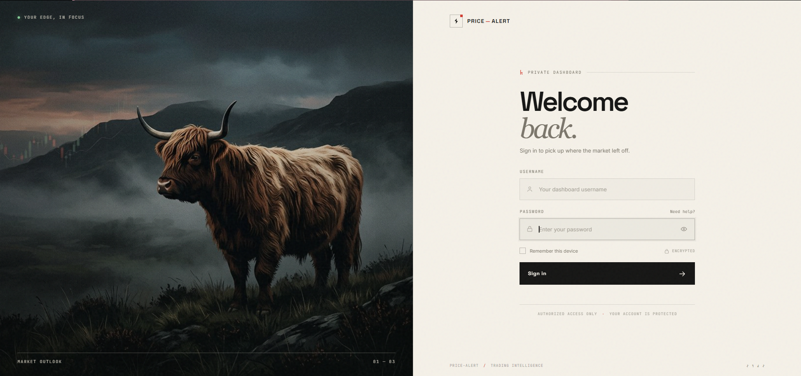
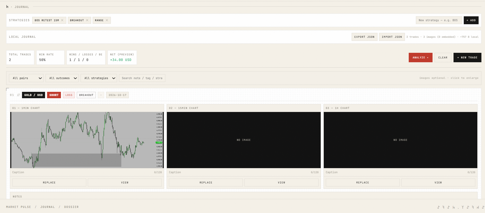
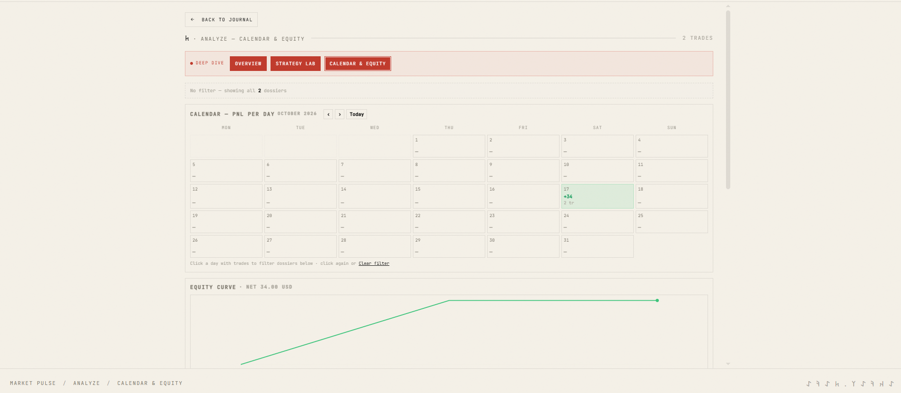
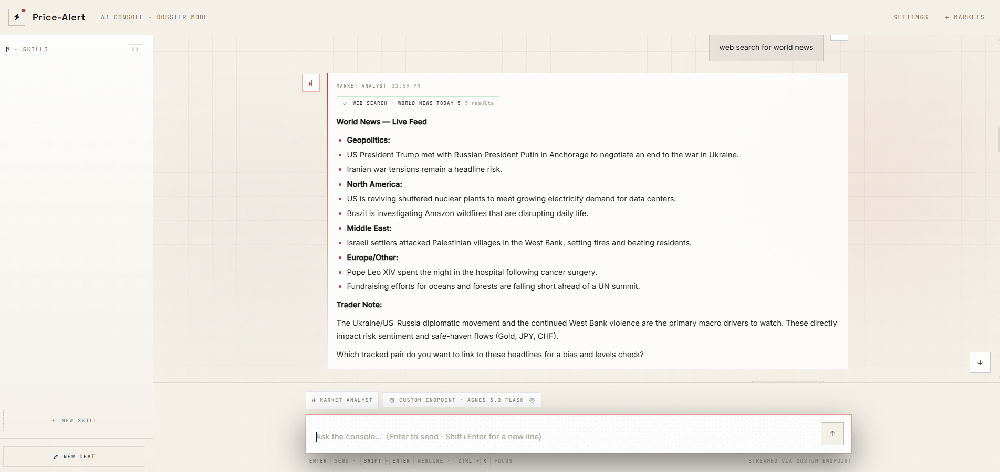
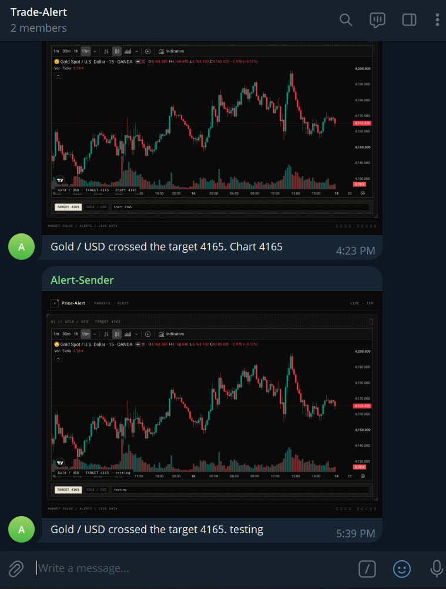
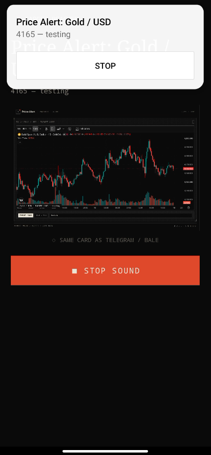

# Price-Alert · Trading Intelligence System

<p align="center">
  
</p>

<p align="center">
  
</p>

<p align="center">
  <a href="#-quick-start"></a>
  <a href="#-features"></a>
  <a href="#-android-companion-app"></a>
  <a href="#-configuration--secrets"></a>
  
</p>

---

## ⚡ Overview

**Price-Alert** is a streamlined, institutional-grade trading intelligence suite. Engineered with an editorial bone-paper aesthetic, it combines real-time multi-asset market surveillance, precision drag-and-drop alert triggers, rich visual chart notifications sent to Telegram/Bale, an urgent native mobile sound alarm app, an encrypted local trade journal, and an integrated AI market analyst console.

Built to run **100% serverless on Cloudflare Workers** (with SQLite-backed Durable Objects and Browser Rendering) or as a standalone local Node.js service, it requires zero heavy databases or expensive infrastructure.

```
┌──────────────────────────────────────────────────────────────────────────────┐
│  LIVE SURVEILLANCE        PRECISION TRIGGERS         MULTI-CHANNEL ALERTS    │
│  Dual TradingView 15m  →  Draw / Drag to Target   →  Cloudflare Browser Run  │
│  Gold · EUR · FX · CFD    Crossing Engine (1 min)    Telegram / Bale / App   │
└──────────────────────────────────────┬───────────────────────────────────────┘
                                       │
┌──────────────────────────────────────┴───────────────────────────────────────┐
│  NATIVE ANDROID COMPANION                        LOCAL JOURNAL DOSSIER       │
│  FCM v1 Push & Foreground Audio Alarm         →  100% Client-Side Private    │
│  Loud Loop Tone · Full-Screen Chart Snapshot     Self-Contained JSON Base64  │
└──────────────────────────────────────────────────────────────────────────────┘
```

---

## ✦ Core Features

- **📊 Multi-Asset Market Surveillance:** Dual 15-minute institutional TradingView charts tracking Gold (`XAU/USD`), Forex majors (`EUR/USD`, `GBP/USD`), Crypto (`BTC/USD`), and Cash Indices (`NAS100USD`, `SPX500USD`).
- **🎯 Visual Drag-to-Alert:** Draw alert lines directly across chart structures or enter numerical targets with custom directional triggers (`Crosses`, `Above`, `Below`).
- **📸 Visual Screenshot Dispatches:** Automated background headless browser captures clean dark-mode chart snapshots with the trigger level highlighted, delivered instantly to Telegram and Bale channels.
- **📱 Native Mobile Alarm Companion:** Dedicated Android app (`android-app/`) with foreground service and FCM Push v1. Plays continuous, loud wake-up audio alarms with vibration and full-screen chart visuals when targets hit.
- **📔 Zero-Leak Local Trade Journal:** Complete trade logging (entry, exit, multi-timeframe charts, risk metrics, strategy tags) saved entirely in browser `localStorage`. Export your entire journal dossier into a single self-contained JSON with embedded compressed JPEG base64 assets.
- **📈 Advanced Performance Analytics:** Visual equity curves, daily PnL calendar matrices, strategy edge breakdowns, and win/loss streak analytics.
- **🤖 Market Intelligence AI Console:** Full-screen conversational terminal with streaming web search, live financial headline synthesis, and technical bias checks.
- **🔒 Zero-Trust Edge Security:** Hardened with signed, HttpOnly, SameSite session cookies, brute-force throttling, and isolated secret management.

---

## ◍ Visual Tour

<div align="center">

### 00 // Private Dashboard Authentication
*Branded editorial gateway with encrypted session persistence and brute-force lockouts.*



<br/><br/>

### 01 // Multi-Asset Markets & Live Targeting
*Dual 15-minute TradingView charts with interactive Draw-to-Alert line placement.*


<br/><br/>

### 02 // Alert Dispatcher & History
*Configurable trigger conditions, target levels, custom execution notes, and active logs.*


<br/><br/>

### 03 // Trade Dossier & Multi-Timeframe Journal
*Structured trade execution records featuring 1m, 15m, and 1h embedded chart dossiers.*



<br/><br/>

### 04 // Strategy Analytics & Equity Performance
*Comprehensive PnL calendar heatmaps, win-rate distributions, and strategy edge lab.*



<br/><br/>

### 05 // AI Market Analyst Console
*Direct streaming terminal for live macroeconomic headlines, sentiment analysis, and bias checks.*



<br/><br/>

<table>
<tr>
<td width="50%" align="center">

### 06 // Telegram Dispatches
*Instant dark-mode chart snapshots delivered to Telegram channels.*



</td>
<td width="50%" align="center">

### 07 // Native Android App Alarm
*Full-screen lock-screen alert with looping loud alarm audio & chart preview.*



</td>
</tr>
</table>

</div>

---

## 🚀 Step-by-Step Setup Guide

Follow this walkthrough to deploy Price-Alert to **Cloudflare Workers** (recommended for 24/7 serverless operation) or run it **locally**, along with configuring the **Android Sound App**.

### Step 1: Clone Repository & Install Dependencies

Ensure you have **Node.js 22+** installed:

```bash
git clone https://github.com/AkhalTeke7/Trading-Alert-System.git
cd Trading-Alert-System
npm ci
```

---

### Step 2: Configure Telegram & Channel Credentials

To receive instant chart notifications and use the interactive bot:

1. **Create your Telegram Bot:**
   - Open Telegram and message [@BotFather](https://t.me/BotFather).
   - Send `/newbot`, name your bot, and copy the **API Token** (`TELEGRAM_BOT_TOKEN`).
2. **Find your Chat ID:**
   - Message your bot or [@userinfobot](https://t.me/userinfobot) to get your numeric **Chat ID** (`TELEGRAM_CHAT_ID`).
   - If using a Channel or Group, add the bot as an administrator and obtain the channel ID (e.g. `-100...`).
3. *(Optional) Bale Messenger Bot:*
   - If using Bale, obtain `BALE_BOT_TOKEN` and `BALE_CHAT_ID` from the Bale Bot Father.

---

### Step 3: Deploy to Cloudflare Workers

Deploy the full serverless stack with automated minute crons, SQLite Durable Objects, and headless browser rendering:

1. **Log in to Cloudflare:**
   ```bash
   npx wrangler login
   ```
2. **Run the Pre-Flight Check & Deploy:**
   ```bash
   npm run check:cloudflare
   npm run deploy:cloudflare
   ```
   *Note: On initial deployment, the worker will return HTTP 503 until you configure your secrets below.*

---

### Step 4: Configure Cloudflare Secrets

Run the following commands to securely set each environment secret in Cloudflare (Wrangler will prompt you for the values without saving them in shell history):

```bash
# 1. Dashboard Authentication (Required)
npx wrangler secret put DASHBOARD_USER
npx wrangler secret put DASHBOARD_PASSWORD

# 2. Telegram Notifications (Required for Telegram alerts)
npx wrangler secret put TELEGRAM_BOT_TOKEN
npx wrangler secret put TELEGRAM_CHAT_ID

# 3. Interactive Telegram Bot & Webhook (Optional)
# Generate a random string: openssl rand -hex 16
npx wrangler secret put TELEGRAM_WEBHOOK_SECRET
# Your personal numeric user ID (restricts unauthorized bot use)
npx wrangler secret put TELEGRAM_ALLOWED_USER_IDS

# 4. Bale Notifications (Optional)
npx wrangler secret put BALE_BOT_TOKEN
npx wrangler secret put BALE_CHAT_ID

# 5. Mobile Push Notifications via Firebase (Optional for instant Android push)
# Paste service account JSON on one line:
npx wrangler secret put FCM_SERVICE_ACCOUNT
```

#### Secrets Reference Table

| Secret Name | Required | Description | Example / Where to obtain |
|:---|:---:|:---|:---|
| `DASHBOARD_USER` | **Yes** | Web dashboard login username | `owner` or `trader` |
| `DASHBOARD_PASSWORD` | **Yes** | Web dashboard login password | Strong passphrase |
| `TELEGRAM_BOT_TOKEN` | Optional | Telegram Bot API token | From [@BotFather](https://t.me/BotFather) |
| `TELEGRAM_CHAT_ID` | Optional | Telegram destination chat/channel ID | Personal ID or `-100...` channel |
| `TELEGRAM_WEBHOOK_SECRET` | Optional | Secret token securing bot webhooks | Generate via `openssl rand -hex 16` |
| `TELEGRAM_ALLOWED_USER_IDS` | Optional | Numeric user IDs allowed to control bot | Comma-separated list: `123456789` |
| `BALE_BOT_TOKEN` | Optional | Bale messenger bot token | From Bale Bot Father |
| `BALE_CHAT_ID` | Optional | Bale recipient chat ID | Destination chat ID |
| `FCM_SERVICE_ACCOUNT` | Optional | Firebase service-account JSON for FCM HTTP v1 | Firebase Console → Service Accounts |

---

### Step 5: Register the Telegram Webhook

Once your Cloudflare Worker is live and secrets are set, register the webhook:

1. Copy `.env.example` to `.env`:
   ```bash
   cp .env.example .env
   ```
2. Edit `.env` with your deployment URL and credentials:
   ```ini
   WORKER_URL=https://trading-alert-system.<your-subdomain>.workers.dev
   TELEGRAM_BOT_TOKEN=your_telegram_bot_token
   TELEGRAM_WEBHOOK_SECRET=your_telegram_webhook_secret
   ```
3. Run the registration script:
   ```bash
   npm run telegram:webhook
   ```

---

### Step 6: Android Companion App Setup

The native Kotlin Android application (`android-app/`) ensures you never miss a trade trigger even when your phone is asleep.

1. **Open the Project:**
   - Launch Android Studio and open the `android-app/` directory.
   - Let Gradle sync (`minSdk 26`, `compileSdk 34`).
2. **Connect to Your Server:**
   - Enter your deployed Cloudflare Worker URL (e.g., `https://trading-alert-system.<subdomain>.workers.dev`) or your local LAN IP (`http://192.168.x.x:3000`).
   - Enter your `DASHBOARD_USER` and `DASHBOARD_PASSWORD`.
3. **Sound Alarm & Polling:**
   - The app runs a background foreground service that polls `/api/triggered` and receives FCM high-priority pushes.
   - When a price triggers, it loops a loud system alarm tone, vibrates, and brings up the full-screen chart display with a prominent **STOP SOUND** action.

---

### Step 7: Alternative — Local Node.js Execution

If you prefer to run the system entirely on your local machine or VPS:

1. Fill in your credentials in `.env`:
   ```bash
   cp .env.example .env
   ```
2. Start the application:
   ```bash
   npm start
   ```
3. In separate terminal tabs, start the price monitor and Telegram bot (if desired):
   ```bash
   npm run prices
   npm run telegram
   ```
4. Access your dashboard at `http://localhost:3000`.

---

## 🛡️ Architecture & Data Sovereignty

- **Durable State:** Cloudflare SQLite Durable Object (`AlertStore`) ensures persistence of pending alerts across serverless worker restarts.
- **Serverless Headless Chrome:** Cloudflare Browser Run captures charts on the fly with no persistent Chrome daemon needed.
- **Client-Side Trade Dossier:** Trade images and journal notes are stored in browser `localStorage`. No journal data or personal trade history is ever transmitted to remote databases. Exports are compiled client-side into self-contained JSON files with compressed base64 images.

---

<p align="center">
  <sub style="color:#8b877b; font-family: JetBrains Mono, monospace; font-size:12px">
    TRADING ALERT SYSTEM · INSTITUTIONAL DOSSIER INTERFACE · MIT / ISC LICENSE
  </sub>
</p>

<p align="center">
  
</p>
